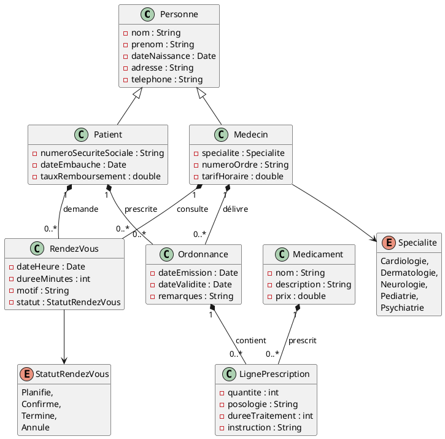

# Application de gestion d'un cabinet médical

## Description du projet et des fonctionnalités implémentées

Notre projet consiste à crée une version simplifié d'un logiciel de gestion déstiné à un centre de soin.
Notre programme contient tout le nécessaire de gestion (ajout, modification, suppression) pour chaques éléments nécessaires à notre centre (médecin, client, médicament)
De plus, celui ci permet de gerer la prise de rendez-vous entre un médecin et un clients en y fixant une date et divers autres éléments
Nous pourrons afficher quelques statistiques, mais aussi rechercher un client ou un médecin.

## Membres du groupe

Louis Dunocq, Hugo Halipré, Eva Nys

## Répartition du travail

| Membre du groupe | Tâches réalisées                                                  | Ticket associé |
|------------------|-------------------------------------------------------------------|----------------|
| Hugo             | Ajout des dépendances nécessaire dans build.graddle               | 2              |
| Eva              | Ajout et modif fichier log4j2.fxml                                | 3              |
| Eva              | Remplace les SOP par des logger dans le fichier main              | 4              |
| Louis            | Remplace les SOP par des logger dans le fichier GestionMedecins   | 5              |
| Hugo             | Remplace les SOP par des logger dans le fichier GestionMedicament | 6              |
| Louis            | Remplace les SOP par des logger dans le fichier GestionOrdonnance | 7              |
| Hugo             | Remplace les SOP par des logger dans le fichier GestionPatients   | 8              |
| Hugo             | Remplace les SOP par des logger dans le fichier GestionRendezVous | 9              |
| Louis            | Remplace les SOP par des logger dans le fichier Recherche         | 10             |
| Hugo             | Remplace les SOP par des logger dans le fichier Statistique       | 11             |
| Eva              | Modification de la classe statistique                             | 12             |
| Hugo             | Découpage du Modèle-Vue-Contrôleur                                | 13             |
| Eva / Louis      | Modification du README.md                                         | 14             |
| Hugo             | Utilisation de ObservableList dans les classes de services        | 15             |
| Eva              | Création du fichier fxml                                          | 16             |
| Hugo             | Création du controller de patient                                 | 17             |
| Eva              | Création du controller de medicaments                             | 18             |
| Louis            | Création du controller de medecin                                 | 19             |
| Hugo             | test patient                                                      | 20             |
| Louis            | test medecin                                                      | 21             |
| Eva              | test medicaments                                                  | 22             |
|                  |                                                                   |                |

## Présentation du code de base

### Diagramme des classes du modèle

### Diagramme des classes "services"

```plantuml
@startuml

top to bottom direction


class GestionMedecins {
  - medecins: List<Medecin>
  + rechercherParSpecialite(Specialite): List<Medecin>
  + ajouterMedecin(Medecin): void
  + rechercherParId(int): Medecin
  + mettreAJourMedecin(int, String, String, double, String, String, Specialite): void
  + getNombreMedecins(): int
  + afficherTousLesMedecins(): void
  + rechercherParNumeroOrdre(String): Medecin
  + listerTousLesMedecins(): List<Medecin>
  + rechercherParNom(String): List<Medecin>
  + supprimerMedecin(int): boolean
}
class GestionMedicaments {
  - medicaments: List<Medicament>
  + rechercherParId(int): Medicament
  + supprimerMedicament(int): boolean
  + ajouterMedicament(Medicament): void
  + listerTousLesMedicaments(): List<Medicament>
  + afficherTousLesMedicaments(): void
  + rechercherParNom(String): List<Medicament>
  + getNombreMedicaments(): int
}
class GestionOrdonnances {
  - ordonnances: List<Ordonnance>
  + listerToutesLesOrdonnances(): List<Ordonnance>
  + ajouterPrescription(int, Medicament, int, String, int, String): void
  + creerOrdonnance(Medecin, Patient, LocalDate, String): Ordonnance
  + getOrdonnancesMedecin(Medecin): List<Ordonnance>
  + getOrdonnancesValides(): List<Ordonnance>
  + getOrdonnancesPatient(Patient): List<Ordonnance>
  + afficherToutesLesOrdonnances(): void
  + rechercherParId(int): Ordonnance
  + getNombreOrdonnances(): int
}
class GestionPatients {
  - patients: List<Patient>
  + rechercherParNumeroSecu(String): Patient
  + mettreAJourPatient(int, String, String, String, String, String, double): void
  + afficherTousLesPatients(): void
  + supprimerPatient(int): void
  + ajouterPatient(Patient): void
  + listerTousLesPatients(): List<Patient>
  + rechercherParId(int): Patient
  + getNombrePatients(): int
  + rechercherParNom(String): List<Patient>
}
class GestionRendezVous {
  - rendezVous: List<RendezVous>
  + prendreRendezVous(Patient, Medecin, LocalDateTime, int, String): RendezVous
  + confirmerRendezVous(int): void
  + getRendezVousParStatut(StatutRendezVous): List<RendezVous>
  + terminerRendezVous(int): boolean
  + getRendezVousPatient(Patient): List<RendezVous>
  + rechercherParId(int): RendezVous
  + annulerRendezVous(int): void
  + getRendezVousMedecin(Medecin): List<RendezVous>
  + estDisponible(Medecin, LocalDateTime): boolean
  + getNombreRendezVous(): int
  + afficherTousLesRendezVous(): void
  + listerTousLesRendezVous(): List<RendezVous>
}
class Main {
  + main(String[]): void
}


Main                -[#595959,dashed]->  GestionMedecins    : "«create»"
Main                -[#595959,dashed]->  GestionMedicaments : "«create»"
Main                -[#595959,dashed]->  GestionOrdonnances : "«create»"
Main                -[#595959,dashed]->  GestionPatients    : "«create»"
Main                -[#595959,dashed]->  GestionRendezVous  : "«create»"
@enduml
```

